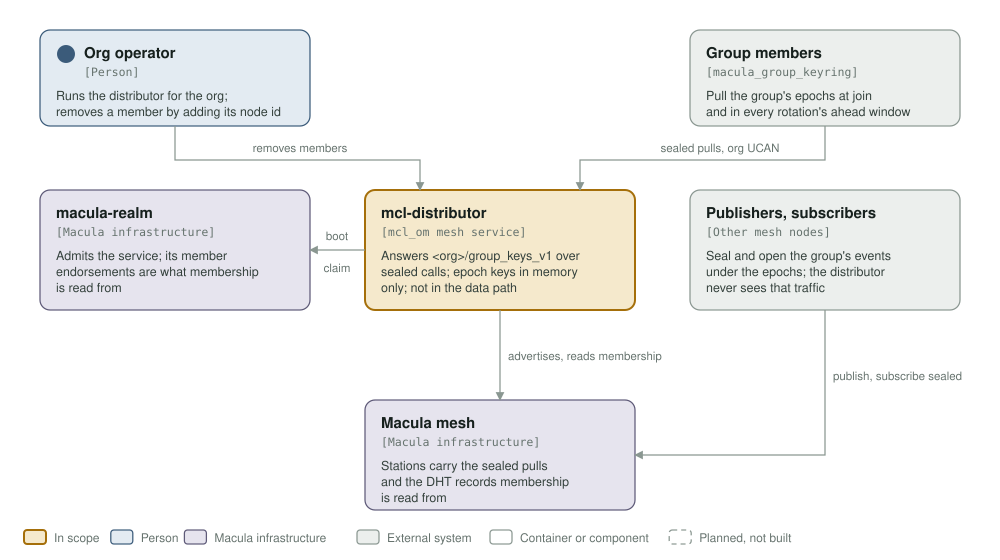
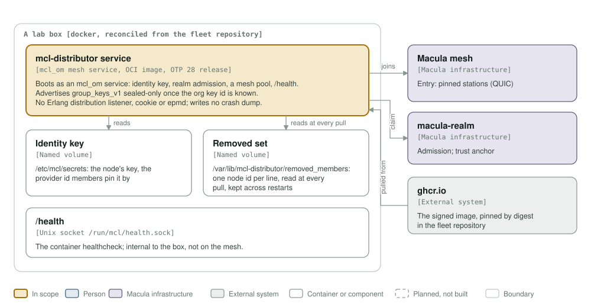
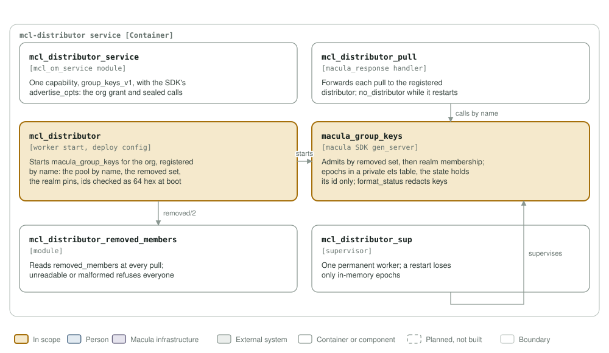

# mcl-distributor architecture

This exists so an org can seal its group's pubsub traffic end to end, with keys
only its admitted members hold, and remove a member for good.

The model follows [C4](https://c4model.com): context, containers, components.
The diagrams are generated by `architecture/c4_diagrams.py` into `assets/`;
change the script, run it, and look at the result before committing.

## Level 1: system context

| Element | Role |
|---------|------|
| mcl-distributor | An `mcl_om` mesh service for one org. Answers `<org>/group_keys_v1` over sealed calls with a group's epochs; keeps them in memory only; never sees the group's traffic. |
| Org operator | Runs the distributor for the org, and removes a member by adding its node id to the removed set. |
| Group members | Each member node's `macula_group_keyring` pulls the epochs at join and in every rotation's ahead window, with the org's `group_keys` UCAN. |
| Publishers, subscribers | Seal and open the group's events under the epochs; the stations carry them, the distributor is not in that path. |
| macula-realm | Admits the service, and endorses the realm's members: membership is read from those endorsements. |
| Macula mesh | Stations carry the sealed pulls; the DHT holds the membership records. |

## Level 2: containers

One OTP release in one image, run under docker on a lab box that reconciles
from the fleet repository. What `mcl_om` provides: the node identity key on a
named volume, realm admission, a mesh pool, `Org/info`, and `/health` on the
Unix socket `/run/mcl/health.sock` (the container healthcheck, never on the
mesh). What the service adds: the org's removed set, a file on its own named
volume at `/var/lib/mcl-distributor`. The node runs without an Erlang
distribution listener (no cookie, no epmd, `-dist_listen false`), so nothing
listens but the mesh pool's own sockets, and the VM writes no crash dump
(`ERL_CRASH_DUMP_SECONDS=0`): a dump copies process heaps, where epoch keys
pass.

## Level 3: components

| Component | What it does |
|-----------|--------------|
| `mcl_distributor_service` | The six `mcl_om_service` callbacks. One capability, `group_keys_v1`, with `macula_group_keys:advertise_opts/1` merged in: the org's `group_keys` grant and `confidential => required`. Omitted until `MCL_GROUP_ORG_KEY_ID` is known. |
| `mcl_distributor_pull` | The `macula_response` handler. Forwards each pull to the distributor registered as `mcl_distributor`; returns a refusal as the SDK names it, and `no_distributor` while the distributor is restarting. |
| `mcl_distributor` | Reads the deploy config and starts `macula_group_keys` for the org: the mesh pool by its registered name (looked up at every membership read), the removed set, the realm pins. Every id from env is exactly 64 hex characters, or the boot stops. |
| `macula_group_keys` | The SDK's distributor (macula >= 14.10). Refuses a removed node, then a node that is not a live realm member; keeps the epochs in a private ets table, its state holding only the table's id; redacts keys in `format_status/1`. |
| `mcl_distributor_removed_members` | Reads the removed set at every pull. A missing file is an empty set; a file it cannot read, or a malformed line, refuses every caller. Checked at boot too. |
| `mcl_distributor_sup` | One permanent worker. A restart loses only in-memory epochs: members holding the current one go on, and new joins wait for it. |

### What a removal does

The operator adds the member's node id to `removed_members`. From its next pull,
the member is refused every epoch, `not_a_member`, whatever its realm
membership or its UCAN says. It keeps the epochs it already holds until their
acceptance ends (DESIGN_E2E_SEALED_PUBSUB §8): a removal stops new keys, not
old ones.
